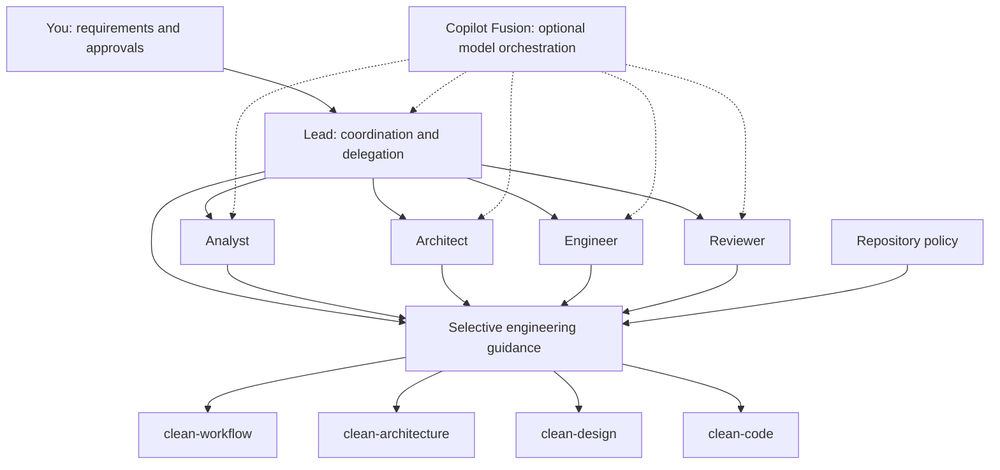

# Clean Skills

Five focused GitHub Copilot agents and four on-demand engineering skills for the **GitHub Copilot app, Visual Studio Code and Visual Studio 2026**. Install once per user and use across local repositories.

Agents own delivery responsibilities; skills provide engineering knowledge; repository coding standards define local conventions. Copilot Fusion is an optional model-selection mechanism, not an agent orchestrator.

## Quick start — install from the repository

Clone this repository, open PowerShell in its root and run:

```powershell
git clone <repository-url>
cd clean-skills
.\Install-Copilot.ps1
```

Replace `<repository-url>` with the actual Git clone URL. If you already cloned the repository to `C:\Projects\clean-skills`, simply run:

```powershell
cd C:\Projects\clean-skills
.\Install-Copilot.ps1
```

No ZIP files, administrator privileges or extra PowerShell modules are required. Review the script before executing it. Windows PowerShell 5.1 or PowerShell 7+ is intended; follow your organisation's execution policy. Do not disable that policy to run the script.

The installer locates its source files relative to the script, not the current working directory:

```text
clean-skills/
├── agents/
│   ├── lead.agent.md
│   ├── analyst.agent.md
│   ├── architect.agent.md
│   ├── engineer.agent.md
│   └── reviewer.agent.md
├── skills/
│   ├── clean-workflow/SKILL.md
│   ├── clean-architecture/SKILL.md
│   ├── clean-design/SKILL.md
│   └── clean-code/SKILL.md
├── Install-Copilot.ps1
└── README.md
```

Each skill directory includes its own references and any applicable commands, scripts and templates. Keep them intact.

### Global installation locations

The default destination is `$HOME/.copilot` (normally `C:\Users\<username>\.copilot` on Windows):

```text
~/.copilot/
├── agents/                 # Five .agent.md profiles
├── skills/                 # Four complete clean-* skill directories
└── engineering-backups/    # Previous versions, outside discovery folders
```

The installer:

- Validates the five source profiles, four skill entry points and explicit skill paths in the profiles.
- Stages complete copies, rewriting `.github/skills/` references in the **installed agent copies only** to the absolute global skills path.
- Backs up and replaces only the named agents and skills; backs up obsolete `delivery`, `delivery-orchestrator`, `product-owner`, `qa-reviewer` `.agent.md` profiles and `clean-refactoring` under this same global root.
- Retains unrelated personal customisations, the source repository and all relative links within the skills. Reports the backup location; attempts rollback on installation failure.

Do not manually move the source agents without adjusting their skill references. They intentionally retain repository-relative `.github/skills/` paths so the same source files work for repository-local installations.

If your client uses a different Copilot configuration root, specify the actual common root explicitly:

```powershell
.\Install-Copilot.ps1 -CopilotHome 'C:\path\to\copilot'
```

This sets the installation destination only; it does not configure a client to discover that path. For remote/WSL sessions, install where the active runtime can discover and read the files. Global installation is local to your user account, not GitHub cloud agents or other users.

### Update or restore

```powershell
git pull --ff-only
.\Install-Copilot.ps1
```

Start a fresh Copilot session after installation. If an update is undesirable, close active sessions, remove the affected managed installed definitions and copy the desired `agents/` and `skills/` entries from the printed backup directory to their original locations. Do not restore the `engineering-backups/` folder itself into a discovery folder. Keep only the desired version of each name.

Check existing repositories and older personal locations (including `%USERPROFILE%\.github\agents`, `~/.agents/skills` and VS Code profile storage) for duplicates. The installer deliberately does not alter those locations. Back up and retire obsolete definitions manually; preserve intentional team overrides.

### Alternative — repository-local installation

For a team, cloud agent, or runtime unable to read global files, copy the five **original** source profiles into the target repository's `.github/agents/` and the four complete skill directories into `.github/skills/`. Back up and replace managed names rather than merging stale files. No path rewriting is needed in the repository-local copies. Do not copy the entire cloned repository, or overwrite unrelated `.github` files. Avoid duplicates with your personal installation; inspect the client's discovery results.

## How-to — configure your Copilot client

Use current client versions and an eligible Copilot account. Availability varies with organisation policy, rollout and selected runtime. Shared file discovery does not guarantee identical tool permissions or delegation.

| Capability | GitHub Copilot app | VS Code (Copilot harness) | Visual Studio 2026 |
| --- | --- | --- | --- |
| Personal agents and skills | Yes | Yes | Yes, current versions |
| Named subagent delegation | Yes | Yes, native `task` tool | Not currently documented as supported |
| Copilot Fusion | Where offered | Where offered | Not assumed; use offered models |

### GitHub Copilot app

1. Open a local session for the actual target repository (not the `clean-skills` clone unless maintaining it).
2. In **Customize → Skills**, confirm all four skills are discovered and enabled. Use the agent picker or `/agent` to select Lead. Verify the other four specialist profiles are available.
3. Choose a supported fixed model for the first smoke test. Then select Copilot Fusion and an effort level if available.

This is the simplest starting point for coordinated delivery because the app supports custom subagents and shares Copilot CLI customisations. For worktree sessions, ensure all handoffs see the same worktree and actual changes.

### Visual Studio Code

1. Open the target repository, update the Copilot extension and choose the **Copilot harness** in the agent/session picker. A local workspace session using the Copilot harness is different from the older **Local harness**.
2. Open the Agent Customizations editor; verify the discovered personal agents and skills. Enable custom agents in Copilot harness settings if disabled.
3. Start a fresh session, select Lead and check delegation with the smoke test. The Copilot harness uses native `task` delegation, not the older Local harness's `runSubagent` tool. Keep the portable agent profiles; inspect actual tool availability rather than adding Local-only tool names blindly.

The older Local harness has different personal-agent locations and is scheduled for retirement in February 2027. This repository targets the Copilot harness, not the Local harness. An agent appearing in the picker does not prove that its tool list works in that session.

### Visual Studio 2026 Professional

Use a current Visual Studio 2026 release (agent skills require 18.5 or later). The latest documented default personal agent location is `%USERPROFILE%\.copilot\agents`; older versions or custom settings may still use `%USERPROFILE%\.github\agents`. Check the configured user-agent directory if profiles are missing. Skills use `%USERPROFILE%\.copilot\skills`.

Open Copilot Chat, check its agent picker and skills/customisation interface, and select the required agent. Use Engineer directly for day-to-day development and Reviewer in a separate session for independent verification. GitHub's documentation currently excludes Visual Studio from automatic subagent support. Do not rely on Lead to delegate automatically here; perform the manual handoffs described below. Fusion is not a requirement.

## How-to — connect repository policy

Keep these in each development repository, not in the global installation:

```text
repository/
├── .github/copilot-instructions.md
├── CODING_STANDARDS.md
└── docs/
    ├── specifications/     # or established location
    └── work-items/         # only for approved formal planning
```

Merge the following into existing `.github/copilot-instructions.md` if useful:

```markdown
Follow CODING_STANDARDS.md for repository policy and conventions.
Use the installed clean-workflow, clean-architecture, clean-design and
clean-code skills selectively according to the task. Load only applicable
references and reuse valid context. Do not introduce formal workflow or
additional abstractions solely because a skill is available.
Surface material conflicts with approved requirements or repository policy.
```

If standards are elsewhere, identify their actual location. Do not assume subagents inherit the entire parent conversation or repository instructions: Lead supplies the applicable policy paths, approved decisions, scope, permissions and expected deliverable on handoff.

## Tutorial — verify before using the full workflow

In a small target repository, select **Engineer** first and ask:

> Read-only check: locate the installed clean-code and clean-design entry points. Open only the relevant guidance for reviewing one existing method. Report the actual paths and one evidenced observation. Do not edit or build.

Confirm the files were actually read and the working tree is unchanged. Then, in Copilot app or the VS Code Copilot harness, select **Lead** and ask:

> Run a read-only delegation smoke test. Invoke Architect as a real custom subagent to inspect one existing project dependency boundary. Ask it to open only relevant clean-architecture guidance and return the source location, evidence and skill path used. Do not edit, build or create work items. If delegation is unavailable, identify the blocker; do not simulate Architect.

Pass only when the UI or tool trace shows an actual named subagent invocation and its returned result, the files were read, and no edits occurred. A self-reported list of agent roles is not evidence of independent review. Repeat with Engineer for a scoped maintainability review. Test with a fixed model before trying Fusion so that model selection and delegation can be diagnosed independently.

## Tutorial — deliver a feature

Select **Lead** in a client that passed the delegation test. Use real paths and work-item IDs, not illustrative placeholders.

| Stage | Prompt | Expected outcome |
| --- | --- | --- |
| Requirements | `Specify <feature>. Delegate to Analyst and have Architect independently challenge it. Do not implement.` | Living specification, criteria and owner decisions |
| Planning | `I approve the complete specification at <path>. Create work items and have Engineer challenge them. Do not implement.` | Reviewed technical work items |
| Implementation | `I authorise implementation of WI-001 and focused local tests. Have Reviewer independently verify it. Do not deploy.` | Code, tests, evidence and independent verdict |
| Evolution | `Revise the specification for <change> and propose a new change-request work item.` | New approved work; previous completed items remain frozen |

Specification approval is separate from implementation authorisation. Lead closes an item only after actual verification evidence and a passing independent review.

For routine development, select Engineer directly or ask Lead: `Fix <defect> within the existing contract, with focused tests and proportionate independent QA. Do not create a work item or change unrelated files.`

### Manual handoffs (Visual Studio or failed delegation)

Use separate specialist sessions rather than asking one session to role-play the entire team. Analyst authors the specification; Architect challenges it; you approve product intent; Architect plans; Engineer challenges the open item; Architect resolves findings; Lead records readiness. After you authorise implementation, Engineer implements and records evidence; Reviewer independently checks actual source/tests; Lead closes the item only on pass. Skip formal planning for a genuinely small change. At each handoff pass source paths, criteria, decisions, scope and permissions; do not pass only the previous agent's conclusion.

## Reference — agents and skills

| Agent | Owns |
| --- | --- |
| Lead | Coordination, handoffs, approval gates, ledger transitions and archival |
| Analyst | Observable product requirements and stable acceptance criteria |
| Architect | Independent requirements challenge, architectural design and technical planning |
| Engineer | Implementability challenge, authorised source/test changes and focused maintainability reviews |
| Reviewer | Independent read-only QA of actual implementation and evidence |

| Skill | Responsibility |
| --- | --- |
| `clean-workflow` | Engineering commands, specifications, work items, review/refactor procedures and delivery evidence |
| `clean-architecture` | System boundaries, dependencies, layer responsibilities and architectural guarantees |
| `clean-design` | Implementation-level design, cohesion, abstractions, smell prevention and refactoring techniques |
| `clean-code` | Naming, readability, language conventions, correctness, reliability, testing and verification |

Use only the smallest relevant references. No mandatory all-skill loading or exhaustive catalogue audits for routine tasks.

### Commands

Where the client exposes skill slash commands, use autocomplete to verify availability:

```text
/clean-workflow review changeset
/clean-workflow refactor OrderService
/clean-workflow recover
```

These are skill modes, not guaranteed native commands in every client. Otherwise ask in plain English, e.g. `Use clean-workflow to review the current changeset without edits.` Ask for `clean-design` when evaluating an abstraction and `clean-code` when implementing cancellation or tests. Refactoring requires authorised scope; review does not grant edit permission.

### Work items

No scaffold is needed for ordinary coding. At the first approved planning task, Lead creates missing `plan.md` and `status.md` from `clean-workflow/templates/work-items/`, in the established work-item root (default `docs/work-items/`). Preserve existing boards. `plan.md` tracks milestones/dependencies; `status.md` tracks active items and transitions. Open items live in `<area>/WI-nnn-*.md`; evidence-complete items are frozen in `done/<area>/`. States: Backlog, Ready, In Progress, In Review, Blocked; Done is represented by archival. IDs stay globally unique. Engineer records implementation evidence; Reviewer returns a verdict; Lead owns status and archival. For old `INDEX.md` boards, reconcile plan and status once and retain history until migration is verified. Older workflow references to Delivery and QA mean Lead and Reviewer.

## Explanation — Fusion and delegation



Lead decides which role should handle a task. The runtime invokes a real subagent in a separate context. Fusion selects and coordinates models where supported; it does not create the role delegation mechanism. Dotted lines are conceptual, not guaranteed independent Fusion sessions or fixed per-agent model routing. Profiles intentionally omit fixed model settings. Start with Standard if offered, use higher effort selectively, and measure correctness, context use, elapsed time and cost. Independent review is still required when the workflow calls for it.

## Troubleshooting

| Symptom | Check |
| --- | --- |
| Profiles missing | Correct runtime, personal discovery root, exact file extension, valid frontmatter, enabled custom agents, new session. |
| Skill missing | A direct `skills/<name>/SKILL.md` exists, correct runtime/home, skill enabled. |
| Profile found, references fail | Inspect installed agent's absolute skill path; confirm the file exists and runtime can read it. Use repository-local installation if sandbox policy prevents access. |
| Wrong/duplicate profile | Inspect personal and workspace definitions, including legacy Delivery aliases; retire only obsolete copies. |
| Lead simulates roles | Check native delegation availability and actual invocation; use named subagents or manual handoffs. Do not weaken tool permissions just to force delegation. |
| Tool-discovery error in VS Code | Use Copilot harness; verify native tool aliases rather than Local-only configurations. |
| Reviewer cannot see edits | Same workspace/worktree, actual diff and source paths, explicit criteria and permissions. |
| Fusion missing | Check account, organisation policy and supported models; use a fixed model. |
| Too slow | Use Engineer directly for small changes; narrow scope, context and verification. |

Tool lists and role instructions are not a security boundary across all hosts. Inspect tool activity; never enable blanket approvals or disable sandboxing as a workaround. If global access is restricted, use the repository-local option.

## Maintenance

Edit source profiles and skills here, commit them, then rerun the installer. Do not edit generated global copies as the source of truth. Use existing regression tests and validation documents when available. The installer checks source layout and explicit paths, not semantic correctness of the skills or live Copilot delegation. Verify Windows installation and the smoke tests before relying on automatic delivery.

Product documentation checked 24 November 2026:

- [Copilot app customisation](https://docs.github.com/en/copilot/how-tos/github-copilot-app/customize-github-copilot-app) and [agent sessions](https://docs.github.com/en/copilot/how-tos/github-copilot-app/agent-sessions)
- [User-level custom agents](https://docs.github.com/en/copilot/how-tos/copilot-cli/use-copilot-cli/invoke-custom-agents) and [personal skills](https://docs.github.com/en/copilot/how-tos/copilot-cli/customize-copilot/add-skills)
- [VS Code agent harnesses](https://code.visualstudio.com/docs/agents/run/agent-harnesses), [agent configuration](https://code.visualstudio.com/docs/agents/reference/custom-agent-file-reference), [migration](https://code.visualstudio.com/docs/agent-customization/migrate-customizations) and [subagents](https://code.visualstudio.com/docs/agents/run/subagents)
- [Visual Studio release notes](https://learn.microsoft.com/en-us/visualstudio/releases/2026/release-notes), [agent skills](https://learn.microsoft.com/en-us/visualstudio/ide/copilot-agent-skills) and [Copilot feature comparison](https://docs.github.com/en/copilot/reference/customization-cheat-sheet)
- [Custom agent configuration](https://docs.github.com/en/copilot/reference/custom-agents-configuration) and [Copilot Fusion](https://docs.github.com/en/copilot/concepts/models/copilot-fusion)
